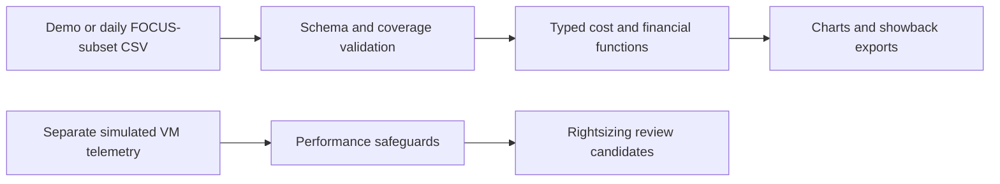
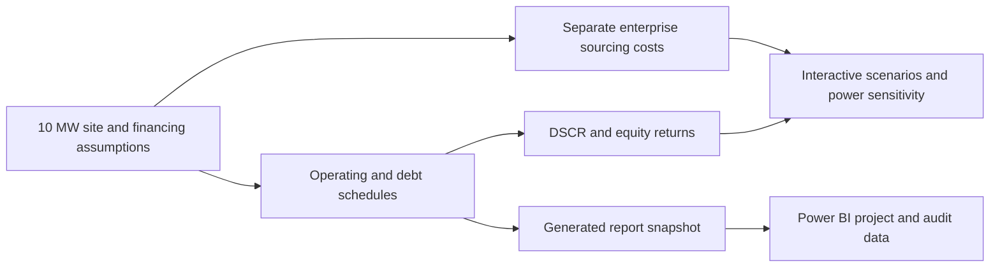

# Luna1 Research — Hiring Manager Guide

**Shy Lee | Infrastructure operations, financial analysis and investment research**

[View the illustrated guide](https://luna1research.com/applied-projects/hiring-manager-guide) · [Applied Projects](https://luna1research.com/applied-projects) · [Professional Resume](https://luna1research.com/recruiter)

This portfolio connects NOC and data-center operating concepts to financial decisions. The projects below are inspectable work samples, not evidence of employer deployments or realized savings.

## Review in five minutes

1. **Luna1 CloudSpend:** change a provider filter, reconcile showback to selected spend, and inspect the CPU, memory and performance safeguards behind a VM rightsizing candidate. Open https://luna1research.com/cloudspend.
2. **Lee Data Center:** raise electricity prices and inspect EBITDA, debt-service coverage and equity returns. Compare cloud, colocation and owned infrastructure separately. Download the formula-based Excel model and current 10 MW Power BI project from the project page.
3. **WD-40 research:** review the separate SDSU CFA Institute Research Challenge profile, company-analysis workstream and publication status at https://luna1research.com/recruiter/research-challenge.

## CloudSpend architecture

CSV inputs are validated before replacing the active dataset. Analysis uses browser tab memory: refresh clears imports and review state. Billing records are not uploaded to an application server. No cloud credentials are requested. Supported imports are daily USD records, capped at 5 MB and 25,000 records. This is a FOCUS-aligned subset, not a conformance validator.

Source map: `src/lib/cloudspend/model.ts` contains calculations; `import.ts` contains validation; `demo.ts` supplies deterministic simulation; `src/components/cloudspend` contains the interactive interface. See `docs/cloudspend/README.md` for detailed definitions and `tests/cloudspend.test.mjs` for reconciliation and ingestion checks.

## Lee Data Center architecture

The model supports phased operations, debt service, equity IRR, NPV and MOIC. The sourcing extension compares common provisioned demand across cloud, colocation and owned infrastructure. It excludes landlord rent receipts and exit proceeds from enterprise TCO. Power sensitivities rerun investment cash flows at alternative electricity rates.

Source map: `src/lib/lee-infrastructure.ts` contains sourcing and power analysis; `scripts/build-lee-power-bi.mjs` generates the five-page report package; `reports/lee-data-center` contains definitions, data and validation notes. Tests in `tests/lee-infrastructure.test.mjs` reconcile cost components and generated report data. Browser scenario edits do not automatically update the existing Excel workbook or Power BI snapshot.

## Design decisions and tradeoffs

- **Separate calculations from charts:** typed, independently testable functions make financial reconciliation easier to review.
- **Keep actuals, forecasts and potential savings distinct:** run-rate forecasts are assumptions; gross optimization estimates are not realized savings. Billed and effective costs are alternative measures, never summed.
- **Require operational evidence:** rightsizing checks memory, peaks, p95 demand, telemetry coverage, workload minimums, latency and I/O. Imported billing alone does not enable rightsizing.
- **Use browser-local processing:** straightforward, credential-free review without storing billing records, at the expense of persistence and scheduled ingestion.
- **Separate enterprise TCO from investor returns:** sourcing choices and landlord investment underwriting answer different questions.
- **Expose uncertainty:** hypothetical prices and workload equivalence are not vendor quotes, benchmarks or secured operating results.

## Verification and limits

Repository commands: `npm run lint`, `npm run type-check`, `npm test`, `npm run build`. Browser workflows are in `e2e/`; financial tests are in `tests/`.

CloudSpend has no tenant accounts, persistent storage, scheduled ingestion or automated infrastructure changes. Production extensions would require authenticated tenant boundaries, secure ingestion, monitoring and approval workflows.

Lee is a hypothetical 10 MW site investment. Power BI data and JSON definitions are validated; native Desktop rendering, DAX execution and refresh remain unverified. The download is an editable PBIP/PBIR project, not a verified PBIX or hosted dashboard.

WD-40 research is a separate company-analysis workstream. Consult its page for publication status; do not infer that a final team report or investment recommendation is complete.

Educational portfolio work only. No confidential employer information, measured employer savings or personalized financial advice is represented.
